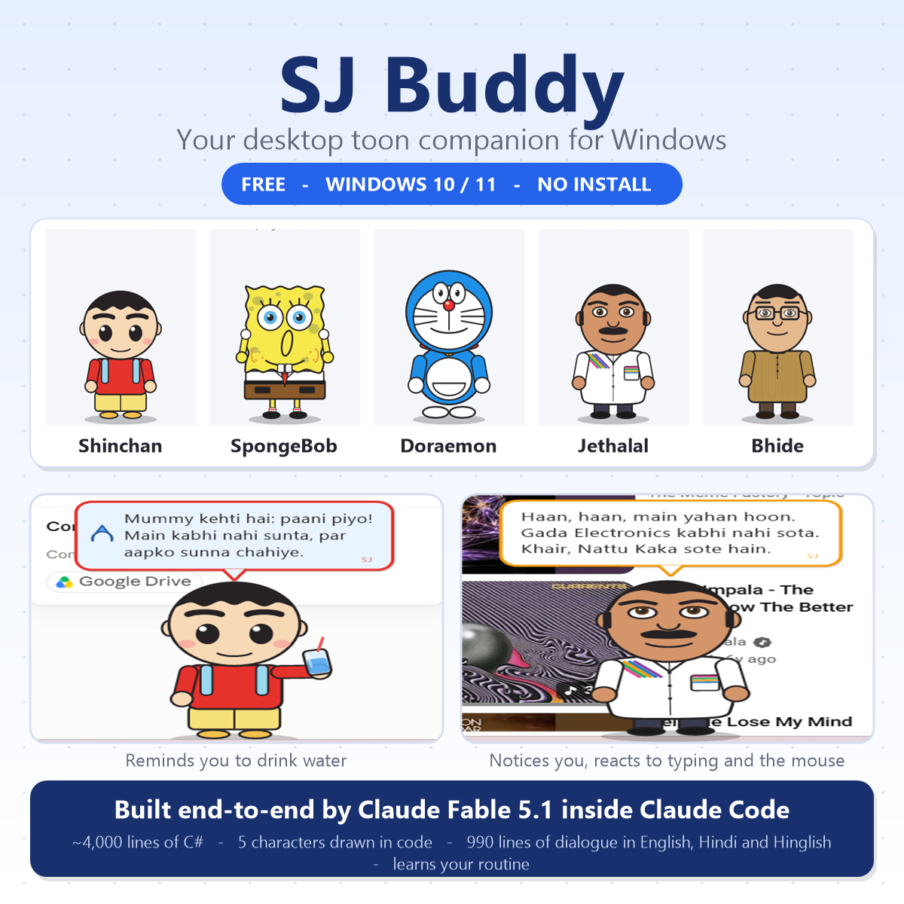
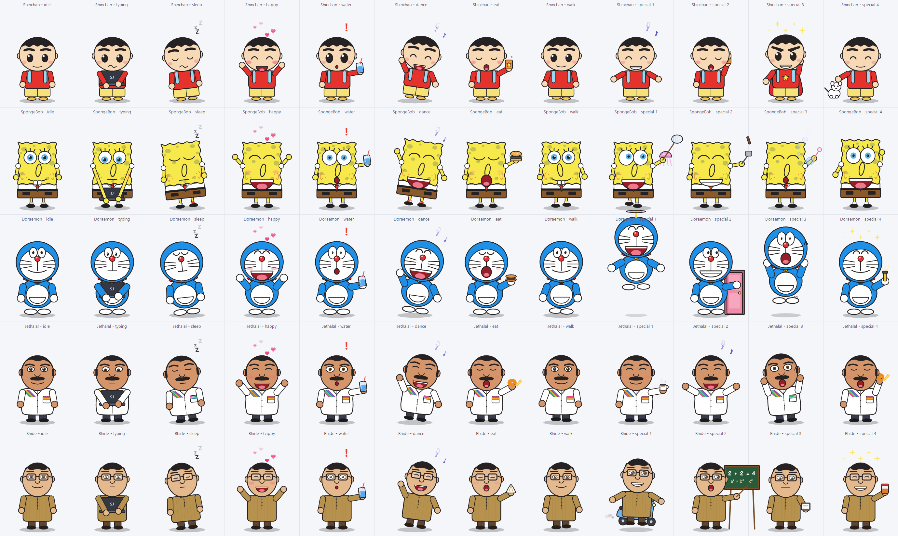

# SJ Buddy

**Your desktop toon companion for Windows.** Shinchan, SpongeBob, Doraemon, Jethalal or Bhide sits above your taskbar, reacts when you type, reminds you to drink water, learns your daily routine, and cracks jokes in English, Hindi and Hinglish.

Free. Windows 10 / 11. No installation. Fully offline. **Made by SJ**, built end-to-end with **Claude Fable 5.1** inside Claude Code.



## Download

**[Download SJ-Buddy-v1.0.zip](../../releases/latest/download/SJ-Buddy-v1.0.zip)** (about 1 MB)

1. Extract the zip anywhere (your Desktop is fine).
2. Double-click `SJ Buddy.exe`.
3. If Windows shows *"Windows protected your PC"*, click **More info** and then **Run anyway**. The app is unsigned (no code-signing certificate), which is why SmartScreen is cautious. The full source is in this repository, and you can rebuild the exe yourself with `build.bat`.
4. Pick your character, name it, choose the water interval, tick **Start with Windows** if you want it every day.

The zip also contains a PDF guide and the source code.

## What it does

- **Reacts to typing.** Opens its little laptop and types along when you type, cheers when you type faster than your own usual speed, rests with calm eyes when you pause, sleeps with Zzz when you are away, and welcomes you back.
- **Reacts to the mouse.** Its eyes follow the cursor, it leans toward it, blushes when you hover over it, and flinches when the mouse zooms past.
- **Water reminders.** Every 30 minutes by default (15 to 90, or off). Waits if you are away, nudges again if ignored, turns serious if you keep ignoring it. Click the buddy after drinking. Tracks sips per day, average, best day and streak.
- **Random actions.** Dance, walk along the taskbar, spin and get dizzy, eat its favourite food, sing, exercise, peek, phone, plus character specials: Doraemon's bamboo copter, Anywhere Door and mouse panic; SpongeBob's jellyfishing, patty flipping and bubbles; Shinchan's buri-buri dance, Chocobi, Action Kamen and Shiro; Jethalal's chai, garba and "Hey Maa Mataji!"; Bhide's scooter Sakharam, tuition board, society register and Madhavi's achar.
- **Talks in character.** About 190 lines per character, each in English, Hindi and Hinglish: greetings by time of day, typing reactions, water lines, click / pet / hover reactions, punchlines, caring lines on bad days, festival wishes and your birthday.
- **Learns your routine.** Usual start and end of the day, lunch hour, peak hours, typing baseline, how you answer reminders, how chatty you like it (clicking a line teaches "more of that"; hiding it right after a line teaches "less"). Levels and titles from *Newbie* to *Desktop Ka Raja*. Right-click, **Stats and what I learned** shows it all in plain words. Rule-based, fully offline.
- **Controls.** Drag to move, click to talk, double-click to pet, right-click for the menu, tray icon near the clock, `Ctrl+Alt+B` to hide / show, **Start with Windows** toggle.



## Privacy

It never records what you type. To know that you are typing it only checks whether typing keys are currently pressed and counts the presses; nothing is stored, logged or sent anywhere. No keyboard hook, no internet, no accounts. Its only files are `settings.txt` and `brain.txt` in `%APPDATA%\SJ Buddy`. Delete that folder to reset everything.

## Add your own lines

Create `my-lines.txt` next to `SJ Buddy.exe` (or in `%APPDATA%\SJ Buddy`), one entry per line:

```
character|category|english|hindi|hinglish
jethalal|quip|Bapuji is watching. Work!|बापूजी देख रहे हैं। काम करो!|Bapuji dekh rahe hain. Kaam karo!
```

`character` is `shinchan`, `spongebob`, `doraemon`, `jethalal`, `bhide` or `*`. Categories include `quip`, `care`, `wisdom`, `water`, `water_ack`, `water_nag`, `click`, `pet`, `hover`, `greet_morning`, `greet_afternoon`, `greet_evening`, `greet_night`, `typing_start`, `typing_fast`, `idle_short`, `lunch`, `late_night`. Placeholders: `{name}`, `{user}`, `{sips}`, `{streak}`, `{level}`.

## Build from source

Run `build.bat`. It needs nothing but Windows itself: it uses the C# compiler that ships with .NET Framework 4.x (`csc.exe`), so there is no SDK to install. Output: `dist\SJ Buddy.exe`.

```
src/          C# sources (Draw.cs = art helpers, Characters.cs = the five characters, Anims.cs = actions,
              Lines*.cs = dialogue, Brain.cs = learning, PetForm.cs = the window and behaviour)
tools/        icon generator (PowerShell), preview-sheet renderer, packaging script
docs/         guide (HTML + PDF), README for the zip, images
```

Useful switches: `"SJ Buddy.exe" --settings` opens Settings, `--stats` opens Stats, `--sheet out.png` renders a pose sheet of all characters. A file named `portable.txt` next to the exe keeps the settings next to the exe (pendrive mode).

## How it was built

The whole app was written by Claude Fable 5.1 in a single Claude Code session from one prompt and seven screenshots: it researched the characters, drew them procedurally in GDI+, designed the learning layer, ran the app and took its own screenshots to find and fix DPI layout bugs, replaced a keyboard hook with a friendlier polling method after an antivirus false positive, and packaged the zip with a PDF guide. Later feedback rounds (remove the laptop logo, fix mouse-triggered typing, drop the voice feature, expand the dialogue to about 190 lines per character) were each turned around in minutes.

Characters belong to their respective creators. This is a fan-made companion for personal use.
